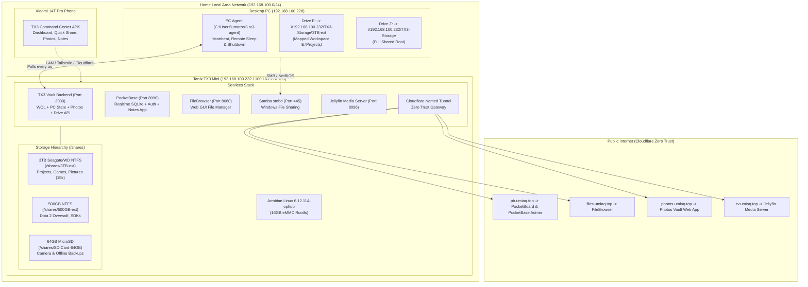

# 🛰️ Tanix TX3 Mini Home Server - Infrastructure & Disaster Recovery

Comprehensive Infrastructure-as-Code and Disaster Recovery blueprint for the **Tanix TX3 Mini Home Server** cluster.

This repository stores all architectural designs, configuration files, systemd services, automount scripts, database schemas, and instant-restore automation. If the host PC is formatted or the TX3 Mini root filesystem needs rebuilding, everything can be restored in seconds.

---

## 🏗️ 1. Architecture Overview



---

## ⚡ 2. Instant Disaster Recovery (Format PC / Reinstall)

### 🖥️ Option A: You just formatted your Windows PC
To reconnect your workspace and restore the companion PC agent in 5 seconds:

1. Open PowerShell and run:
   ```powershell
   git clone https://github.com/umarislah86-collab/tx3-mini-infrastructure.git C:\temp_restore
   powershell -ExecutionPolicy Bypass -File C:\temp_restore\restore_pc.ps1
   ```
2. **What this does automatically**:
   * Maps `Z:` to `\\192.168.100.232\TX3-Storage` (full storage).
   * Maps `E:` to `\\192.168.100.232\TX3-Storage\3TB-ext` (restores `E:\Projects`).
   * Installs and runs the PC Agent in `C:\Users\umarosli\.tx3-agent\` for Remote Sleep/Shutdown & WOL.
   * Registers `RemoteShutdown.lnk` in Windows Startup.

---

### 💽 Option B: You flashed/reinstalled Armbian on the TX3 Mini
To restore the entire server stack from scratch:

1. SSH into the freshly booted TX3 Mini:
   ```bash
   ssh root@192.168.100.232
   ```
2. Run the master restore script:
   ```bash
   git clone https://github.com/umarislah86-collab/tx3-mini-infrastructure.git /opt/tx3-restore
   cd /opt/tx3-restore
   chmod +x restore_tx3.sh
   sudo ./restore_tx3.sh
   ```
3. **What this does automatically**:
   * Installs all dependencies (`python3-pil`, `samba`, `ntfs-3g`, `sqlite3`, etc.).
   * Restores `systemd` units for all services (`dota-vault`, `pocketbase`, `filebrowser`, `smbd`).
   * Restores `/etc/udev/rules.d/99-tx3-usb-mount.rules` and `/usr/local/bin/tx3-usb-mount.sh`.
   * Configures persistent `/etc/fstab` with `nofail` and storage UUIDs.
   * Deploys the multi-storage Command Center backend to `/opt/tx3-vault`.
   * Re-initializes PocketBase with the Realtime Notes schema.

---

## 📦 3. System Components & Services

| Service | Port | Internal URL | Public Cloudflare Domain | Purpose |
| :--- | :--- | :--- | :--- | :--- |
| **Command Center & Photos** | `3030` | `http://192.168.100.232:3030` | `https://photos.umiaq.top` | PC WOL, Sleep/Shutdown, System Stats, Photos Vault, Drive Explorer |
| **PocketBase DB & Notes** | `8090` | `http://192.168.100.232:8090/_/` | `https://pb.umiaq.top` | Embedded SQLite, Realtime SSE, Notes/Task Board |
| **FileBrowser** | `8080` | `http://192.168.100.232:8080` | `https://files.umiaq.top` | Web GUI File Management |
| **Samba (SMB)** | `445` | `smb://192.168.100.232/TX3-Storage` | N/A (LAN/VPN) | Native Windows File Explorer Drive (`Z:` and `E:`) |
| **Jellyfin** | `8096` | `http://192.168.100.232:8096` | `https://tv.umiaq.top` | Media Streaming |
| **WebDAV** | `8085` | `http://192.168.100.232:8085` | `https://dav.umiaq.top` | WebDAV Sync |

---

## 💾 4. Storage Architecture (`/shares`)

* **Internal eMMC (16GB)**: Hosts Armbian OS, system packages, PocketBase binaries, and `/opt/tx3-vault` (command center backend). Independent of external storage.
* **3TB External HDD (`/shares/3TB-ext`)**:
  * **UUID**: `A29E14DE9E14ACB3` (NTFS)
  * **Contents**: `Projects` (active workspaces), `Games`, `SteamLibrary`, `Pictures` (15,411 indexed family photos).
* **500GB External HDD (`/shares/500GB-ext`)**:
  * **UUID**: `449243E99243DE54` (NTFS)
  * **Contents**: `Dota2 overwolf`, `sdk`, `rrdownload`.
* **64GB MicroSD (`/shares/SD-Card-64GB`)**:
  * **UUID**: `FBFC-D15C` (exFAT)
  * **Contents**: Quick mobile uploads, photo dumps, SD card camera sync.

---

## 🔒 5. Credentials & Default Secrets

> [!NOTE]
> All credentials below are configured across the cluster.

* **Linux Root / SSH**:
  * User: `root`
  * Pass: `1234`
  * Port: `22`
* **Samba & WebDAV**:
  * User: `umarosli`
  * Pass: `umar24434`
* **PocketBase Superuser**:
  * Email: `admin@umiaq.top`
  * Pass: `umar24434`
* **FileBrowser**:
  * User: `admin` / `umarosli`
  * Pass: `admin` / `umar24434`

---

## 📱 6. Mobile & Client Apps
* **TX3 Companion Android APK**: Located at `G:\My Drive\Umar\project tx3\TX3-Command-Center.apk`
* **PocketBoard Realtime Web App**: Source in `apps/pocketboard/`, live at `https://pb.umiaq.top/`
